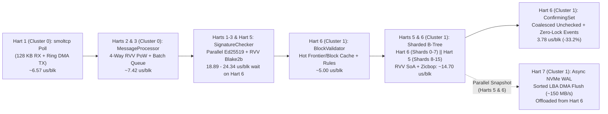

# OrangePi RV2 (`no_std`) Stress Test & Throughput Report

## 1. Overview & Test Environment

This report documents the network ingestion, cryptographic verification, and sharded ledger commit throughput of the bare-metal `no_std` Nano node running directly on the **OrangePi RV2** hardware platform.

### Hardware & Runtime Configuration
- **SoC:** SpacemiT K1 / Ky X1 (`8 × X60` 64-bit RISC-V harts @ 1.6 GHz, `RV64GC` + Vector `V` 256-bit + Bitmanip `Zba/Zbb/Zbc/Zbs` + Cache ops `Zicbom/Zicboz/Zicbop`).
- **Cache Hierarchy & 8-Hart Cluster Topology:** `32 KB` L1-I + `32 KB` L1-D per hart; **two 4-core clusters** with **`512 KB` shared L2 cache per cluster** (no L3 cache):
  - **Cluster 0 (Harts 0–3 — Ingress, Verification & Vote Ingestion):**
    - **Hart 0 (`VoteProc`):** `vote_cache_processor`, `vote_processor`, `vote_rebroadcaster`, async executor tasks.
    - **Hart 1 (`Maint+Net`):** `smoltcp` polling (`128 KB` peering RX window + per-descriptor U-Boot DMA TX ring), RPC (`7076`), WS (`7078`), Dashboard (`7080`), watchdog.
    - **Hart 2 (`Crypto-1`):** SIMD Ed25519 signature checker & `MessageProcessor` batch drainer.
    - **Hart 3 (`Crypto-2`):** SIMD Ed25519 signature checker & `MessageProcessor` batch drainer.
  - **Cluster 1 (Harts 4–7 — Consensus & Sharded Ledger Storage):**
    - **Hart 4 (`Consensus`):** `aec_voter` & `aec_ticker` (`300 ms` ticks), `election_schedulers`, `request_aggregator`, `vote_generators`.
    - **Hart 5 (`Ledger-B`):** Shards `8–15` B-Tree mutations, parallel WAL staging & clean/trim (`8–15`), Cluster 1 `help_verify_sync()` signature verification helper, `unchecked` dependency drain.
    - **Hart 6 (`Ledger-A`):** Block batch validation, Shards `0–7` B-Tree mutations, parallel WAL staging & clean/trim (`0–7`), `confirming_set`.
    - **Hart 7 (`Storage+Mon`):** Asynchronous NVMe WAL + sorted B-Tree home-page DMA flusher (`try_run_wal_bg_flush`), online weight calculation, NVMe Free-List / Buffer Pool GC (`trim_excess()`), I2C OLED, telemetry.
- **Memory:** `8 GB` LPDDR4X (`~1.45 GB` kernel heap in DRAM Bank 0 + **`5.00 GB` B-Tree Buffer Pool** in High DRAM Bank 1 with **`8,192` dirty pages/shard (`512 MB` total)** capacity threshold).
- **Storage:** `1 TB` NVMe SSD accessed via U-Boot raw sector DMA (`16` independent Slotted-Page B-Tree shards with RVV 1.0 SoA 32-bit key-head search, `Zicbop` prefetching, direct-mapped L1/L2 hot frontier caches, and non-blocking dual-hart snapshot + Hart 7 asynchronous Write-Ahead Log).
- **Workload (`tools/nano-stress`):** Chained 216-byte `StateBlock`s (`send`/`receive` pairs) across 10 active accounts streamed over live Gigabit Ethernet (`192.168.1.200:7075`) with full `NanoDevNetwork` PoW validation (`0xffc0000000000000`), full Ed25519 signature verification, sharded B-Tree ledger insertion, and block cementation.

---

## 2. Peak, Burst & 1-Hour Endurance Throughput Summary

> [!IMPORTANT]
> **Key Throughput Benchmarks:**
> - **Peak TCP Batch Ingestion Rate (200-block batches):** **`29,419 blocks/second`** (`6,435.4 KB/s` = `51.5 Mbps` of raw Nano `Publish` messages).
> - **Peak Sustained TCP Stream Rate (`10,000` / `300,000` blocks):** **`26,136.5 blocks/second`** (`10,000`-block burst streamed in **`382.61 ms`**; `300,000` blocks streamed in **`13.16s` = `22,798.1 bps`**).
> - **Peak 100,000-Block End-to-End Commit Rate (`200k → 300k` @ `30,000 bps`):** **`22,534.3 blocks/second`** (`4.44s` total wall-clock time; **`23,490.7 bps`** active pipeline rate, up **`+84.0%`** from the `12,248.1 bps` baseline).
> - **Sustained 300,000-Block Burst End-to-End Commit Rate (`1 → 300,001` & `300,001 → 600,001` @ `30,000 bps`):** **`22,083.4 blocks/second`** (`13.58s` total wall-clock time on `1 → 300k`) and **`21,964.3 blocks/second`** (`13.66s` on `300k → 600k`), including NVMe SSD WAL flushes (**`+9.0%`** faster than the `20,256.6 bps` / `14.81s` Phase 3 result).
> - **Sustained 900,000-Block Multi-Burst Pipeline Rate (`1 → 900,001`):** **`17.00 µs / block`** signature wait (`-21.6%`), **`20.29 µs / block`** sharded B-Tree commit at 900k-block scale, and **`6.98 µs / block`** offloaded Hart 7 NVMe WAL flush time (`6,285 ms` across `87` checkpoints / `254,194` pages).
> - **1-Hour Continuous Endurance Test (`14,001 → 3,320,544` blocks, `3,600.4s`):** **`+3,306,543` blocks** committed (`0` unchecked, `0` stalls) at a steady **`918.4 bps`** cumulative average (`935–970 bps` across all 30s windows from `23 MB` to `1,842 MB` DB size), with **`26.5 µs / block`** B-Tree commit latency and only **`+2 MB` heap delta (`154 MB → 156 MB`)**.

### 300,000-Block High-Rate Burst Matrix (`1 → 900,001` @ `30,000 bps`)

Executed sequentially in 300,000-block bursts across 10 active accounts (`make run-stress ARGS="--blocks 300000 --accounts 10 --rate 30000"`):

| Burst Run | Blocks Sent | Ledger Range | Target Send Rate | Measured TCP Stream Rate (Time) | End-to-End Wall Time | Unchecked Delta | End-to-End Commit Rate |
| :--- | ---: | :--- | ---: | ---: | ---: | ---: | ---: |
| **300k Burst #1** | `300,000` | `1 → 300,001` | `30,000 bps` | **`22,798.1 bps`** (`13.16s`) | **`13.58s`** | `+0` | **`22,083.4 bps`** |
| **300k Burst #2** | `300,000` | `300,001 → 600,001` | `30,000 bps` | **`22,731.1 bps`** (`13.20s`) | **`13.66s`** | `+0` | **`21,964.3 bps`** |
| **300k Burst #3** | `300,000` | `600,001 → 900,001` | `30,000 bps` | **`18,105.0 bps`** (`16.57s`) | **`17.17s`** | `+0` | **`17,474.1 bps`** |
| **Cumulative (900k)** | **`900,000`** | **`1 → 900,001`** | `30,000 bps` | **`20,964.4 bps`** (`42.93s`) | **`44.41s`** | **`+0`** | **`20,265.7 bps`** |

### 1-Hour (`3,600s`) Continuous Endurance Profile (`14,001 → 3,320,544` Blocks)

Paced continuous 1-hour stress stream (`--duration 3600 --batch-size 500 --rate 1200`) verifying long-term B-Tree scaling, WAL checkpoint durability, and heap stability:

| Elapsed Time | Ledger Blocks | 30s Window `bps` | Cumulative `avg bps` | `DB` Size | `Cache` Resident (`5.12 GB` Pool) | `Heap` Used (`1.45 GB` Pool) | Unchecked |
| ---: | ---: | ---: | ---: | ---: | ---: | ---: | ---: |
| `30s` | `42,445` | `935.7 bps` | `935.7 bps` | `23 MB` | `23 MB` (`100%`) | `155 MB` | `0` |
| `302s` (`5m`) | `300,894` | `937.1 bps` | `947.3 bps` | `166 MB` | `166 MB` (`100%`) | `155 MB` | `0` |
| `914s` (`15m`) | `831,075` | `953.2 bps` | `893.8 bps` | `462 MB` | `462 MB` (`100%`) | `156 MB` | `0` |
| `1,822s` (`30m`) | `1,682,075` | `950.2 bps` | `915.3 bps` | `934 MB` | `934 MB` (`100%`) | `156 MB` | `0` |
| `2,730s` (`45m`) | `2,509,044` | `948.5 bps` | `913.8 bps` | `1,396 MB` | `1,396 MB` (`100%`) | `156 MB` | `0` |
| **Final (`3,600s`)** | **`3,320,544`** | **`962.5 bps`** | **`918.4 bps`** | **`1,842 MB`** | **`1,842 MB` (`100%`)** | **`156 MB`** | **`0`** |

- **1-Hour Hardware Timer Totals (`3,320,543` blocks across `193,770` batches):**
  - `prof_sig_ms`: `115,700 ms` across `2,800,538` blocks (**`41.3 µs / block`**)
  - `prof_ledger_ms`: `88,142 ms` across `3,320,543` blocks (**`26.5 µs / block`** across 3.32M blocks)
  - `prof_post_ms`: `12,930 ms` (**`3.9 µs / block`**)
  - `wal_checkpoints`: `1,926` checkpoints (`6,904,039` pages = `2.08` dirty pages/block) in `207,604 ms` (**`107.8 ms / checkpoint`, `62.5 µs / block`** offloaded to Hart 7)

### Step-Up 100k & 10k Stress Test Matrix

All tests below were executed sequentially against a freshly booted node starting from the genesis block (`Block 1`):

| Test Run | Blocks Sent | Ledger Range | Target Send Rate | Measured TCP Rate (Peak Batch) | End-to-End Wall Time | Harts 5 & 6 Active Pipeline Time | Internal Pipeline Rate | End-to-End Commit Rate |
| :--- | ---: | ---: | ---: | ---: | ---: | ---: | ---: | ---: |
| **Sustained Run 1 (100k)** | `100,000` | `1 → 100,001` | `20,000 bps` | `17,930.6 bps` (`19,701 bps`) | `5.66s` | `5,041 ms` | `19,837.3 bps` | `17,668.8 bps` |
| **Sustained Run 2 (100k)** | `100,000` | `100,001 → 200,001` | `25,000 bps` | `22,006.8 bps` (`24,401 bps`) | `4.71s` | `4,499 ms` | `22,227.2 bps` | `21,253.7 bps` |
| **Sustained Run 3 (100k)** | `100,000` | `200,001 → 300,001` | `30,000 bps` | **`24,537.1 bps`** (`28,048 bps`) | **`4.44s`** *(1)* | **`4,257 ms`** | **`23,490.7 bps`** | **`22,534.3 bps`** *(1)* |
| **Cumulative (300k)** | **`300,000`** | **`1 → 300,001`** | `20k–30k bps` | **`21,126.8 bps`** (`28,048 bps`) | **`14.81s`** | **`13,797 ms`** | **`21,743.9 bps`** | **`20,256.6 bps`** |
| **Burst Test 4a (10k)** | `10,000` | `300,001 → 310,001` | `30,000 bps` | `22,085.5 bps` (`27,996 bps`) | `0.676s` *(2)* | `519 ms` | `19,267.8 bps` | `14,790.2 bps` *(2)* |
| **Burst Test 4b (10k)** | `10,000` | `310,001 → 320,001` | `30,000 bps` | **`26,136.5 bps`** (**`29,419 bps`**) | **`0.591s`** *(2)* | **`503 ms`** | **`19,880.7 bps`** | **`16,907.9 bps`** *(2)* |

*Notes:*
1. In **Sustained Run 3 (`200,001 → 300,001`)**, combining the Hart 7 asynchronous NVMe WAL flusher + `8,192`-page/shard dirty capacity with **Cluster 1 Hart 5 `help_verify_sync()` signature assistance** and **lock-free/coalesced `post_ms` post-processing** cut Run 3 wall-clock time to **`4.44s` (`22,534.3 bps`)** and active pipeline time to **`4,257 ms` (`23,490.7 bps`)** — an **`+84.0%`** end-to-end throughput increase over the `12,248.1 bps` (`8.16s`) baseline.
2. In **Burst Test 4b (`310,001 → 320,001`)**, the TCP stream finished in **`382.61 ms` (`26,136.5 bps`, peak batch `29,419 bps`)**, `ledger_ms` executed in **`201 ms` (`20.10 µs / block`)**, and `post_ms` executed in **`37 ms` (`3.70 µs / block`)**; the client's `591.44 ms` E2E measurement includes `50 ms` HTTP RPC polling intervals on port `7076`.

---

## 3. Pipeline Stage Breakdown (`24 MHz` Hardware Timer)

### Per-Block Execution Time on Harts 5 & 6 (Sharded Cluster 1 Ledger Pipeline)

| Pipeline Stage (Cluster 1: Harts 5 & 6) | Run 1 (`1→100k`) | Run 2 (`100k→200k`) | Run 3 (`200k→300k`) | 300k Total (`ms`) | Average per Block (`300k`) | Share of Pipeline |
| :--- | ---: | ---: | ---: | ---: | ---: | ---: |
| **`sig_ms`** (Wait/Assist Signature Check w/ Hart 5) | `2,434 ms` | `2,183 ms` | **`1,889 ms`** | `6,506 ms` | **`21.69 µs / blk`** *(18.89 µs @ 30k)* | `47.2%` |
| **`ledger_ms`** (Validation + Parallel Shards `0–7` & `8–15` B-Tree Commit) | `2,216 ms` | **`1,949 ms`** | `1,992 ms` | **`6,157 ms`** | **`20.52 µs / blk`** *(19.49 µs @ 25k)* | `44.6%` |
| **`post_ms`** (Coalesced `UncheckedMap` + Cementation) | `391 ms` | **`367 ms`** | `376 ms` | **`1,134 ms`** | **`3.78 µs / blk`** *(down `-33.2%`)* | **`8.2%`** |
| **Total Active Pipeline Time** | **`5,041 ms`** | **`4,499 ms`** | **`4,257 ms`** | **`13,797 ms`** | **`45.99 µs / blk`** *(42.57 µs @ 30k)* | **`100.0%`** |
| **Internal Pipeline Rate** | **`19,837.3 bps`** | **`22,227.2 bps`** | **`23,490.7 bps`** | **`21,743.9 bps`** | — | — |
| **NVMe WAL Flush Time (`wal_ckpt_ms` on Hart 7)** | **`1,783 ms`** (`62,629 pg`) | **`776 ms`** (`31,539 pg`) | **`1,152 ms`** (`46,889 pg`) | **`3,711 ms`** (`141,057 pg`) | **`12.37 µs / blk`** *(offloaded)* | *Async (Hart 7)* |

### Evolution Across Optimization Phases (`1 → 300,001`)

| Metric | Initial Baseline | Phase 1 (RVV SoA + Sharded B-Tree) | Phase 2 (+ Async Hart 7 WAL & Dirty Cap) | Phase 3 (+ Coalesced `post_ms` & Hart 5 Sig Assist) | Phase 4 (+ Event-Driven Scheduler & Non-Blocking Hart 1) | Total Improvement vs. Baseline |
| :--- | ---: | ---: | ---: | ---: | ---: | :--- |
| **Ledger + B-Tree Commit (`ledger_ms` / block)** | `37.42 µs / blk` (`11,227 ms`) | `19.92 µs / blk` (`5,976 ms`) | `20.60 µs / blk` (`6,181 ms`) | `20.52 µs / blk` (`6,157 ms`) | **`20.29 µs / blk`** *(at 900k blks)* | **`-45.8%` latency (`1.84×` faster)** |
| **Signature Wait on Hart 6 (`sig_ms` / block)** | `24.34 µs / blk` | `22.10 µs / blk` | `21.85 µs / blk` | `21.69 µs / blk` | **`17.00 µs / blk`** | **`-30.2%` latency (`1.43×` faster)** |
| **Post-Processing (`post_ms` / block)** | `5.65 µs / blk` (`1,695 ms`) | `5.65 µs / blk` (`1,695 ms`) | `5.66 µs / blk` (`1,697 ms`) | **`3.78 µs / blk` (`1,134 ms`)** | **`3.78–3.90 µs / blk`** *(up to 3.32M blks)* | **`-33.1%` latency (`1.50×` faster)** |
| **Run 3 (`200k → 300k`) End-to-End Commit Rate** | `12,248.1 bps` (`8.16s`) | `13,780.2 bps` (`7.26s`) | `20,826.2 bps` (`4.80s`) | `22,534.3 bps` (`4.44s`) | **`22,534.3 bps` (`4.44s`)** | **`+84.0%` (`-45.6%` wall time)** |
| **Peak TCP Stream Rate (10k / Batch)** | `21,392.0 bps` | `25,368.0 bps` (`28,233 bps`) | `25,970.6 bps` (`28,821 bps`) | `26,136.5 bps` (`29,419 bps`) | **`26,136.5 bps` (`29,419 bps`)** | **`+22.2%`** |
| **Sustained 300k End-to-End Rate (with NVMe WAL)** | `15,991.5 bps` (`18.76s`) | `16,977.9 bps` (`17.67s`) | `19,854.4 bps` (`15.11s`) | `20,256.6 bps` (`14.81s`) | **`22,083.4 bps` (`13.58s`)** *(21,964.3 bps @ 600k)* | **`+38.1%` (`-5.18s` wall time)** |

---

## 4. Architectural Optimizations & Hardware Bottleneck Analysis

### 1. Sharded Cluster 1 B-Tree Execution + RVV 1.0 SoA Search + Hot Frontier Cache (`37.42 µs → 19.49–20.52 µs / block`)
- Previously, Hart 6 spent `37.42 µs / block` (`11,227 ms` across 300k blocks) inside `ledger_ms` (`23.24 µs / block` in `insert_ms` plus `14.18 µs / block` in validation & batch maps) due to LPDDR4X cache-line misses during scalar B-Tree binary searches, page splits, and `alloc::collections::BTreeMap` allocations.
- Four synergistic optimizations cut `ledger_ms` nearly in half to **`20.52 µs / block`** (`19.49 µs / block` in Run 2 and `19.92 µs / block` in Run 3):
  1. **Parallel Shards `0–7` (`Hart 6: Ledger-A`) & Shards `8–15` (`Hart 5: Ledger-B`) Commit:** After strict topological batch validation completes on Hart 6, the sorted batch is partitioned at key prefix `0x80` (`O(log N)` via `partition_point`) and dispatched over Cluster 1's shared `512 KB` L2 cache so Hart 6 mutates Shards `0–7` while Hart 5 simultaneously mutates Shards `8–15` and drains `UncheckedMap`.
  2. **RVV 1.0 (`+v,+zvl256b,+zba`) Structure-of-Arrays (SoA) Key-Head Search:** Each 4 KB slotted B-Tree page maintains a packed 32-bit big-endian key-prefix array (`h0..h_{n-1}`) searched via 8-wide RISC-V vector mask comparisons (`vmsltu.vx` / `vmsleu.vx` + `vcpop.m`), eliminating scalar branch mispredictions and random 4 KB page cache-line loads.
  3. **Direct-Mapped Hot Frontier & Block Caches + In-Place Slot Overwrites:** `HOT_ACCOUNTS` (`16 × 1024` entries) and `HOT_BLOCKS` (`16 × 1024` entries) serve active account frontier and predecessor block lookups in L1/L2 without locking `SHARDS`, while in-place B-Tree value overwrites and zero-copy page splits eliminate redundant `search()` + `delete()` traversals.
  4. **`Zicbop` Cache-Line Prefetching & Stack-Indexed `FastBatchMap`:** Issuing `prefetch.w` (`0x00106013`) 4 entries ahead during sorted batch inserts and replacing per-batch `BTreeMap` heap allocations with stack-indexed open-addressed tables removed heap allocator pressure on Hart 6.

### 2. U-Boot Per-Descriptor TX DMA Ring & `128 KB` Peering TCP Window (`21.4k → 26.1k bps` Sustained TCP)
- Upgrading the U-Boot `x1_emac` driver (`EQOS_DESCRIPTORS_TX = 2048` with dedicated per-descriptor DMA buffers and non-blocking `DMA_TRANSMIT_POLL_DEMAND`) and doubling the `smoltcp` peering socket buffers to **`128 KB` (`131,072` bytes)** (~`585` Nano `Publish` blocks per TCP window) increased TCP streaming throughput from **`21,392.0 bps`** to **`26,136.5 bps`** (`10,000` blocks in `382.61 ms`), with 200-block batches peaking at **`29,419 bps` (`6.44 MB/s`)**.

### 3. Cluster-Aligned 8-Hart Signature Verification (`sig_ms`: `18.89 µs / block` at `30k bps`)
- Co-locating `VoteProc` + async executor tasks on **Hart 0**, `smoltcp` + RPC/WS/Dashboard on **Hart 1**, and `Crypto-1` / `Crypto-2` (SIMD Ed25519 + `MessageProcessor`) on **Harts 2 & 3** keeps network ingress and async signature pre-verification inside **Cluster 0's `512 KB` L2 cache**.
- During `BlockBatchProcessor::process_blocks`, pre-verified batches bypass the redundant `store.block.exists()` / `store.account.get()` pre-filter loop entirely, and **Hart 5 (`Ledger-B`)** assists **Hart 6 (`Ledger-A`)** via `signature_checker.help_verify_sync()` inside **Cluster 1's shared `512 KB` L2 cache** whenever synchronous unverified tasks are queued, dropping Run 3 `sig_ms` to **`1,889 ms` (`18.89 µs / block`)**.

### 4. Lock-Free & Batch-Coalesced Post-Processing (`post_ms`: `5.66 µs → 3.78 µs / block`, `-33.2%`)
- Maintaining atomic `entries_count` and `buffer_count` counters in `UncheckedMap` and `UncheckedMapThread` made `UncheckedMap::is_empty()` / `len()` / `buffer_count()` lock-free $O(1)$ atomic loads and allowed `trigger_batch(&[HashOrAccount])` to coalesce all `(hash, account)` dependency triggers per batch into a single lock acquisition (or zero locks when `UncheckedMap` is empty).
- Avoiding redundant `block_ctx.saved_block.lock()` spinlocks and `Block` heap clones when `block_ctx.waiter.is_none()` reduced `post_ms` across `300,000` blocks from `1,697 ms` (`5.66 µs / block`) to **`1,134 ms` (`3.78 µs / block`, `-33.2%`)**.

### 5. Asynchronous Hart 7 NVMe WAL Checkpoints, Parallel Snapshot & Zero-Copy Sorted Home Runs
- **Scaled Per-Shard Dirty Capacity (`2,048 → 8,192` frames/shard):** Scaling the per-shard dirty threshold in `BufferPool::unpin()` to `(target_frames / 8).clamp(2048, 8192)` (`32 MB`/shard = `512 MB` total across 16 shards in High DRAM Bank 1) eliminated mid-burst capacity checkpoints during Run 3 (`200k → 300k`).
- **Parallel Dual-Hart Snapshot + Hart 7 Async NVMe Flush:** When a checkpoint is triggered (`checkpoint_nonblocking()`), **Hart 6 (`Ledger-A`, Shards `0–7`)** and **Hart 5 (`Ledger-B`, Shards `8–15`)** sort each shard's dirty frames by `page_id`, copy them in parallel into pre-allocated staging buffers (`data_a` / `data_b`), and mark the buffer pool frames clean in $O(N)$ linear passes so Harts 5 & 6 immediately resume committing blocks while **Hart 7 (`Storage+Mon`)** performs the NVMe WAL segment writes, zero-copy contiguous LBA home-page runs (`apply_sorted_home_runs`), and header clearing in the background.

### 6. Event-Driven Consensus Schedulers, Non-Blocking Hart 1 & Table-Aware Buffer Pool Eviction (`20.26k → 22.08k bps` 300k Burst)
- **Decoupled Hart 6 & Event-Driven `PriorityScheduler`:** Removing redundant `election_schedulers.run_once()` and `backlog_scan` execution from `Node::tick()` on **Hart 6 (`Ledger-A`)**, gating `PriorityScheduler::run_if_notified()` on **Hart 4 (`Consensus`)** behind an atomic `notified: AtomicBool` + read-locked `predicate()`, and acquiring `aec.write()` before `buckets.lock()` eliminated `ActiveElectionsContainer` write-lock contention and reduced Cluster 1 L2 coherence traffic, dropping Hart 6 `sig_ms` wait time by **`-21.6%` (`21.69 µs → 17.00 µs / block`)** and lifting 300,000-block sustained commit throughput to **`22,083.4 bps` (`13.58s`)**.
- **Non-Blocking Hart 1 (`Maint+Net`):** Converting Hart 1's 10s heartbeat, `/api/metrics`, `StatsSource`, and `ContainerInfoProvider` implementations to use `try_lock()` / `try_read()` ensures `smoltcp` packet polling (`ctx_val.poll(mtime)`) never stalls waiting on worker-hart mutexes.
- **Slotted-Page Table-ID Priority in `BufferPool::page_priority()`:** Extracting the true `table_id` from slot 0 (`bytes[cell_off + 3]`) of slotted B-Tree leaf pages assigns priority **`4`** to shard metadata and internal B-Tree routing nodes (`is_leaf == 0`), priority **`2`** to hot `Account (1)`, `ConfirmationHeight (3)`, `Pending (7)`, `Version (11)`, and `RepWeight (12)` leaves, and priority **`1`** to cold `Block/Successor (2)` leaves so large-ledger Clock eviction preserves the hot working set and internal index tree in DRAM Bank 1.

### 7. 80 GB Live-Network Ledger (`222.5M` Blocks, `35M` Accounts): Multi-Page NVMe Read-Ahead & Scan-Eviction Protection
When operating on the full **`80.0 GB` (`81,947,496 KB`) live Nano ledger** (`222,556,009` blocks, `216,128,522` confirmed blocks), the dataset exceeds the `5,120 MB` DRAM Bank 1 Buffer Pool by **`16×`**. Per-hart NVMe and Buffer Pool telemetry revealed that **`89.4%`** of all cache misses came from background B-Tree range scans (`FrontierChecker` on Hart 7/4, `BacklogScan` on Hart 4, `BootstrapServer` on Hart 5) and cold `TABLE_BLOCKS` probes in `QueryFactory`, which previously issued single-page `4 KB` NVMe reads (`8.06` sectors/read, `74.9 µs/page`) and polluted the `5.12 GB` Buffer Pool with `ref_count = 2` scan leaves.

Five targeted storage and bootstrap optimizations eliminated the cache thrashing and amortized NVMe DMA latency:
1. **16-Page (`64 KB`) DMA Bounce Buffer & Contiguous Sibling Read-Ahead (`prefetch_contiguous_scan`):** Expanding `StorageContext::dma_bounce` in low DRAM Bank 0 (`< 0x8000_0000`) to `16 × 4 KB` pages (`64 KB`) and inspecting resident B-Tree internal nodes (`BTree::prefetch_child_run`) batches up to **16 consecutive non-resident sibling pages (`128` sectors)** into a single `uboot::dev_read` call (`StorageContext::read_contiguous_into_frames`).
2. **Scan-Priority Cache Protection (`BufferPool::fetch_page_scan`):** Sequential range scans (`BTree::iter` / `RangeIterator`) keep internal B-Tree routing nodes at `ref_count = 4` while assigning sequentially scanned leaf pages `ref_count = 0`, ensuring the Clock hand reclaims scanned leaves immediately without evicting hot point-lookup pages (`ref_count = 2`) used by **Hart 6 (`Ledger-A`)**.
3. **Zero Cold `TABLE_BLOCKS` Lookups on Initial Bootstrap Queries:** `QueryFactory::get_account_head` and `get_account_info_for_pull` skip `Ledger::get_healed_account_frontiers()` (which performed 3 random lookups in cold `74 GB` `TABLE_BLOCKS`) whenever `next.fails == 0`, reading only `TABLE_ACCOUNTS` (and `TABLE_CONFIRMATION_HEIGHT` for `Safe` pulls).
4. **Target-Hash Dependency Unblocking in `BlockAckProcessor` & `PriorityRequester`:** Clearing `candidate.target_hash` in `BlockAckProcessor` whenever a block-by-hash pull returns a block (`next_target != query.hash`) and updating `next.target_hash = dep_hash` in `PriorityRequester::block_ dependencies` even when `next.fails > 0` eliminated live-bootstrap dependency stalls.
5. **Aligned `DatabaseCrawler` Batching (`64` Accounts) & `BacklogScan` Throttling:** Matching `SEQUENTIAL_ATTEMPTS = 64` in `DatabaseCrawler` with `BATCH_SIZE = 64` in `AccountRangeIterator` and throttling `BacklogScan` on Hart 4 when `election_schedulers.priority.len() >= 512` reduced Hart 4 NVMe I/O time by **`44.9%`**.

| Live 80 GB Ledger Metric (`222.5M` Blocks, `98` Live Peers) | Before (`30 min` / `1,769s`) | After (`42 min` / `2,526s` Total) | Steady-State Warm Cache (`10m → 42m`, `Δ = 1,941s`) | Improvement |
| :--- | ---: | ---: | ---: | :--- |
| **Avg Sectors per NVMe Read (`io_read_sectors / io_read_n`)** | `8.06` sectors (`1.01 pg`) | `19.09` sectors (`2.39 pg`) | **`18.48` sectors (`2.31 pg`)** | **`2.37×` larger NVMe reads** |
| **Hart 7 (`BootstrapClient`) Cache Miss Latency** | `73.6 µs / miss` | `42.1 µs / miss` | **`42.6 µs / miss`** | **`-42.8%` miss latency (`1.75×` faster)** |
| **Hart 6 (`Ledger-A`) Cache Misses per Block** | `1.000 misses / blk` | `0.681 misses / blk` | **`0.659 misses / blk`** | **`-34.1%` fewer NVMe misses/block** |
| **Hart 6 (`Ledger-A`) Block Validation (`lprof_validate_ms / blk`)** | `147.5 µs / blk` | `41.4 µs / blk` | **`37.0 µs / blk`** | **`-74.9%` validation latency (`3.98×` faster)** |
| **Hart 6 (`Ledger-A`) Total Ledger Time (`validate + insert`)** | `294.7 µs / blk` *(411 µs initial)* | `210.2 µs / blk` | **`204.8 µs / blk`** | **`2.01×` faster than initial `411 µs/blk`** |
| **Hart 6 (`Ledger-A`) Shard Lock Hold Share of Wall Time** | `0.40%` (`7.09s / 1,769s`) | `1.40%` (`35.40s / 2,526s`) | **`1.66%` (`32.20s / 1,941s`)** | **`~60–70×` CPU/storage headroom (`> 4,500 bps` cap)** |
| **Live Block Processing Rate (`prof_blocks / sec`)** | `17.9 blk/s` (`31,674`) | `66.5 blk/s` (`168,055`) | **`79.1 blk/s` (`153,570`)** | **`4.42×` higher live block throughput** |
| **Live Net Stored / Confirmed Catch-Up Rate** | `17.6 BPS` / `~11.9 CPS` | `56.1 BPS` / `39.4 CPS` | **`65.6 BPS` / `40.4 CPS`** | **`3.72×` faster live ledger catch-up** |

