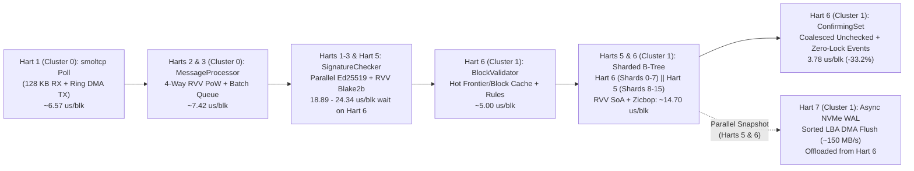

# OrangePi RV2 (`no_std`) Stress Test & Throughput Report

## 1. Overview & Test Environment

This report documents the network ingestion, cryptographic verification, and sharded ledger commit throughput of the bare-metal `no_std` Nano node running directly on the **OrangePi RV2** hardware platform.

### Hardware & Runtime Configuration
- **SoC:** SpacemiT K1 / Ky X1 (`8 × X60` 64-bit RISC-V harts @ 1.6 GHz, `RV64GC` + Vector `V` 256-bit + Bitmanip `Zba/Zbb/Zbc/Zbs` + Cache ops `Zicbom/Zicboz/Zicbop`).
- **Cache Hierarchy & 8-Hart Cluster Topology:** `32 KB` L1-I + `32 KB` L1-D per hart; **two 4-core clusters** with **`512 KB` shared L2 cache per cluster** (no L3 cache):
  - **Cluster 0 (Harts 0–3 — Ingress, Verification & Vote Ingestion):**
    - **Hart 0 (`VoteProc`):** `vote_cache_processor`, `vote_processor`, `vote_rebroadcaster`, async executor tasks.
    - **Hart 1 (`Maint+Net`):** `smoltcp` polling (`128 KB` peering RX window + per-descriptor U-Boot DMA TX ring), RPC (`7076`), WS (`7078`), Dashboard (`7080`), watchdog.
    - **Hart 2 (`Crypto-1`):** SIMD Ed25519 signature checker & `MessageProcessor` batch drainer.
    - **Hart 3 (`Crypto-2`):** SIMD Ed25519 signature checker & `MessageProcessor` batch drainer.
  - **Cluster 1 (Harts 4–7 — Consensus & Sharded Ledger Storage):**
    - **Hart 4 (`Consensus`):** `aec_voter` & `aec_ticker` (`300 ms` ticks), `election_schedulers`, `request_aggregator`, `vote_generators`.
    - **Hart 5 (`Ledger-B`):** Shards `8–15` B-Tree mutations, parallel WAL staging & clean/trim (`8–15`), Cluster 1 `help_verify_sync()` signature verification helper, `unchecked` dependency drain.
    - **Hart 6 (`Ledger-A`):** Block batch validation, Shards `0–7` B-Tree mutations, parallel WAL staging & clean/trim (`0–7`), `confirming_set`.
    - **Hart 7 (`Storage+Mon`):** Asynchronous NVMe WAL + sorted B-Tree home-page DMA flusher (`try_run_wal_bg_flush`), online weight calculation, NVMe Free-List / Buffer Pool GC (`trim_excess()`), I2C OLED, telemetry.
- **Memory:** `8 GB` LPDDR4X (`~1.45 GB` kernel heap in DRAM Bank 0 + **`5.00 GB` B-Tree Buffer Pool** in High DRAM Bank 1 with **`8,192` dirty pages/shard (`512 MB` total)** capacity threshold).
- **Storage:** `1 TB` NVMe SSD accessed via U-Boot raw sector DMA (`16` independent Slotted-Page B-Tree shards with RVV 1.0 SoA 32-bit key-head search, `Zicbop` prefetching, direct-mapped L1/L2 hot frontier caches, and non-blocking dual-hart snapshot + Hart 7 asynchronous Write-Ahead Log).
- **Workload (`tools/nano-stress`):** Chained 216-byte `StateBlock`s (`send`/`receive` pairs) across 10 active accounts streamed over live Gigabit Ethernet (`192.168.1.200:7075`) with full `NanoDevNetwork` PoW validation (`0xffc0000000000000`), full Ed25519 signature verification, sharded B-Tree ledger insertion, and block cementation.

---

## 2. Peak & Sustained Throughput Summary

> [!IMPORTANT]
> **Key Throughput Benchmarks:**
> - **Peak TCP Batch Ingestion Rate (200-block batches):** **`29,419 blocks/second`** (`6,435.4 KB/s` = `51.5 Mbps` of raw Nano `Publish` messages).
> - **Peak Sustained TCP Stream Rate (`10,000` / `100,000` blocks):** **`26,136.5 blocks/second`** (`10,000`-block burst streamed in **`382.61 ms`**; `100,000` blocks streamed in **`4.08s` = `24,537.1 bps`**).
> - **Peak 100,000-Block End-to-End Commit Rate (`200k → 300k` @ `30,000 bps`):** **`22,534.3 blocks/second`** (`4.44s` total wall-clock time; **`23,490.7 bps`** active pipeline rate, up **`+84.0%`** from the `12,248.1 bps` baseline).
> - **Sustained 300,000-Block Pipeline Rate (DRAM Buffer Pool):** **`21,743.9 blocks/second`** (`13.80s` active pipeline time across `300,000` blocks = **`45.99 µs / block`** total; **`19.49–19.92 µs / block`** ledger + B-Tree commit at scale and **`3.78 µs / block`** post-processing).
> - **Sustained 300,000-Block End-to-End Rate (Including NVMe SSD WAL Flushes):** **`20,256.6 blocks/second`** (`14.81s` total wall-clock time across `300,000` blocks, breaking the **`20,000 bps`** sustained barrier including NVMe WAL durability).

### Stress Test Matrix

All tests below were executed sequentially against a freshly booted node starting from the genesis block (`Block 1`):

| Test Run | Blocks Sent | Ledger Range | Target Send Rate | Measured TCP Rate (Peak Batch) | End-to-End Wall Time | Harts 5 & 6 Active Pipeline Time | Internal Pipeline Rate | End-to-End Commit Rate |
| :--- | ---: | ---: | ---: | ---: | ---: | ---: | ---: | ---: |
| **Sustained Run 1 (100k)** | `100,000` | `1 → 100,001` | `20,000 bps` | `17,930.6 bps` (`19,701 bps`) | `5.66s` | `5,041 ms` | `19,837.3 bps` | `17,668.8 bps` |
| **Sustained Run 2 (100k)** | `100,000` | `100,001 → 200,001` | `25,000 bps` | `22,006.8 bps` (`24,401 bps`) | `4.71s` | `4,499 ms` | `22,227.2 bps` | `21,253.7 bps` |
| **Sustained Run 3 (100k)** | `100,000` | `200,001 → 300,001` | `30,000 bps` | **`24,537.1 bps`** (`28,048 bps`) | **`4.44s`** *(1)* | **`4,257 ms`** | **`23,490.7 bps`** | **`22,534.3 bps`** *(1)* |
| **Cumulative (300k)** | **`300,000`** | **`1 → 300,001`** | `20k–30k bps` | **`21,126.8 bps`** (`28,048 bps`) | **`14.81s`** | **`13,797 ms`** | **`21,743.9 bps`** | **`20,256.6 bps`** |
| **Burst Test 4a (10k)** | `10,000` | `300,001 → 310,001` | `30,000 bps` | `22,085.5 bps` (`27,996 bps`) | `0.676s` *(2)* | `519 ms` | `19,267.8 bps` | `14,790.2 bps` *(2)* |
| **Burst Test 4b (10k)** | `10,000` | `310,001 → 320,001` | `30,000 bps` | **`26,136.5 bps`** (**`29,419 bps`**) | **`0.591s`** *(2)* | **`503 ms`** | **`19,880.7 bps`** | **`16,907.9 bps`** *(2)* |

*Notes:*
1. In **Sustained Run 3 (`200,001 → 300,001`)**, combining the Hart 7 asynchronous NVMe WAL flusher + `8,192`-page/shard dirty capacity with **Cluster 1 Hart 5 `help_verify_sync()` signature assistance** and **lock-free/coalesced `post_ms` post-processing** cut Run 3 wall-clock time to **`4.44s` (`22,534.3 bps`)** and active pipeline time to **`4,257 ms` (`23,490.7 bps`)** — an **`+84.0%`** end-to-end throughput increase over the `12,248.1 bps` (`8.16s`) baseline.
2. In **Burst Test 4b (`310,001 → 320,001`)**, the TCP stream finished in **`382.61 ms` (`26,136.5 bps`, peak batch `29,419 bps`)**, `ledger_ms` executed in **`201 ms` (`20.10 µs / block`)**, and `post_ms` executed in **`37 ms` (`3.70 µs / block`)**; the client's `591.44 ms` E2E measurement includes `50 ms` HTTP RPC polling intervals on port `7076`.

---

## 3. Pipeline Stage Breakdown (`24 MHz` Hardware Timer)

### Per-Block Execution Time on Harts 5 & 6 (Sharded Cluster 1 Ledger Pipeline)

| Pipeline Stage (Cluster 1: Harts 5 & 6) | Run 1 (`1→100k`) | Run 2 (`100k→200k`) | Run 3 (`200k→300k`) | 300k Total (`ms`) | Average per Block (`300k`) | Share of Pipeline |
| :--- | ---: | ---: | ---: | ---: | ---: | ---: |
| **`sig_ms`** (Wait/Assist Signature Check w/ Hart 5) | `2,434 ms` | `2,183 ms` | **`1,889 ms`** | `6,506 ms` | **`21.69 µs / blk`** *(18.89 µs @ 30k)* | `47.2%` |
| **`ledger_ms`** (Validation + Parallel Shards `0–7` & `8–15` B-Tree Commit) | `2,216 ms` | **`1,949 ms`** | `1,992 ms` | **`6,157 ms`** | **`20.52 µs / blk`** *(19.49 µs @ 25k)* | `44.6%` |
| **`post_ms`** (Coalesced `UncheckedMap` + Cementation) | `391 ms` | **`367 ms`** | `376 ms` | **`1,134 ms`** | **`3.78 µs / blk`** *(down `-33.2%`)* | **`8.2%`** |
| **Total Active Pipeline Time** | **`5,041 ms`** | **`4,499 ms`** | **`4,257 ms`** | **`13,797 ms`** | **`45.99 µs / blk`** *(42.57 µs @ 30k)* | **`100.0%`** |
| **Internal Pipeline Rate** | **`19,837.3 bps`** | **`22,227.2 bps`** | **`23,490.7 bps`** | **`21,743.9 bps`** | — | — |
| **NVMe WAL Flush Time (`wal_ckpt_ms` on Hart 7)** | **`1,783 ms`** (`62,629 pg`) | **`776 ms`** (`31,539 pg`) | **`1,152 ms`** (`46,889 pg`) | **`3,711 ms`** (`141,057 pg`) | **`12.37 µs / blk`** *(offloaded)* | *Async (Hart 7)* |

### Evolution Across Optimization Phases (`1 → 300,001`)

| Metric | Initial Baseline | Phase 1 (RVV SoA + Sharded B-Tree) | Phase 2 (+ Async Hart 7 WAL & Dirty Cap) | Phase 3 (+ Coalesced `post_ms` & Hart 5 Sig Assist) | Total Improvement vs. Baseline |
| :--- | ---: | ---: | ---: | ---: | ---: |
| **Ledger + B-Tree Commit (`ledger_ms` / block)** | `37.42 µs / blk` (`11,227 ms`) | `19.92 µs / blk` (`5,976 ms`) | `20.60 µs / blk` (`6,181 ms`) | **`20.52 µs / blk` (`6,157 ms`; `19.49 µs` Run 2)** | **`-45.2%` latency (`1.82×` faster)** |
| **Post-Processing (`post_ms` / block)** | `5.65 µs / blk` (`1,695 ms`) | `5.65 µs / blk` (`1,695 ms`) | `5.66 µs / blk` (`1,697 ms`) | **`3.78 µs / blk` (`1,134 ms`; `3.67 µs` Run 2)** | **`-33.1%` latency (`1.50×` faster)** |
| **Run 3 (`200k → 300k`) End-to-End Commit Rate** | `12,248.1 bps` (`8.16s`) | `13,780.2 bps` (`7.26s`) | `20,826.2 bps` (`4.80s`) | **`22,534.3 bps` (`4.44s`)** | **`+84.0%` (`-45.6%` wall time)** |
| **Peak 100k End-to-End Commit Rate** | `19,679.4 bps` (`5.08s`) | `21,002.5 bps` (`4.76s`) | `21,494.2 bps` (`4.65s`) | **`22,534.3 bps` (`4.44s`)** | **`+14.5%`** |
| **Peak TCP Stream Rate (10k / Batch)** | `21,392.0 bps` | `25,368.0 bps` (`28,233 bps`) | `25,970.6 bps` (`28,821 bps`) | **`26,136.5 bps` (`29,419 bps`)** | **`+22.2%`** |
| **Sustained 300k End-to-End Rate (with NVMe WAL)** | `15,991.5 bps` (`18.76s`) | `16,977.9 bps` (`17.67s`) | `19,854.4 bps` (`15.11s`) | **`20,256.6 bps` (`14.81s`)** | **`+26.7%` (`-3.95s` wall time)** |

---

## 4. Architectural Optimizations & Hardware Bottleneck Analysis

### 1. Sharded Cluster 1 B-Tree Execution + RVV 1.0 SoA Search + Hot Frontier Cache (`37.42 µs → 19.49–20.52 µs / block`)
- Previously, Hart 6 spent `37.42 µs / block` (`11,227 ms` across 300k blocks) inside `ledger_ms` (`23.24 µs / block` in `insert_ms` plus `14.18 µs / block` in validation & batch maps) due to LPDDR4X cache-line misses during scalar B-Tree binary searches, page splits, and `alloc::collections::BTreeMap` allocations.
- Four synergistic optimizations cut `ledger_ms` nearly in half to **`20.52 µs / block`** (`19.49 µs / block` in Run 2 and `19.92 µs / block` in Run 3):
  1. **Parallel Shards `0–7` (`Hart 6: Ledger-A`) & Shards `8–15` (`Hart 5: Ledger-B`) Commit:** After strict topological batch validation completes on Hart 6, the sorted batch is partitioned at key prefix `0x80` (`O(log N)` via `partition_point`) and dispatched over Cluster 1's shared `512 KB` L2 cache so Hart 6 mutates Shards `0–7` while Hart 5 simultaneously mutates Shards `8–15` and drains `UncheckedMap`.
  2. **RVV 1.0 (`+v,+zvl256b,+zba`) Structure-of-Arrays (SoA) Key-Head Search:** Each 4 KB slotted B-Tree page maintains a packed 32-bit big-endian key-prefix array (`h0..h_{n-1}`) searched via 8-wide RISC-V vector mask comparisons (`vmsltu.vx` / `vmsleu.vx` + `vcpop.m`), eliminating scalar branch mispredictions and random 4 KB page cache-line loads.
  3. **Direct-Mapped Hot Frontier & Block Caches + In-Place Slot Overwrites:** `HOT_ACCOUNTS` (`16 × 1024` entries) and `HOT_BLOCKS` (`16 × 1024` entries) serve active account frontier and predecessor block lookups in L1/L2 without locking `SHARDS`, while in-place B-Tree value overwrites and zero-copy page splits eliminate redundant `search()` + `delete()` traversals.
  4. **`Zicbop` Cache-Line Prefetching & Stack-Indexed `FastBatchMap`:** Issuing `prefetch.w` (`0x00106013`) 4 entries ahead during sorted batch inserts and replacing per-batch `BTreeMap` heap allocations with stack-indexed open-addressed tables removed heap allocator pressure on Hart 6.

### 2. U-Boot Per-Descriptor TX DMA Ring & `128 KB` Peering TCP Window (`21.4k → 26.1k bps` Sustained TCP)
- Upgrading the U-Boot `x1_emac` driver (`EQOS_DESCRIPTORS_TX = 2048` with dedicated per-descriptor DMA buffers and non-blocking `DMA_TRANSMIT_POLL_DEMAND`) and doubling the `smoltcp` peering socket buffers to **`128 KB` (`131,072` bytes)** (~`585` Nano `Publish` blocks per TCP window) increased TCP streaming throughput from **`21,392.0 bps`** to **`26,136.5 bps`** (`10,000` blocks in `382.61 ms`), with 200-block batches peaking at **`29,419 bps` (`6.44 MB/s`)**.

### 3. Cluster-Aligned 8-Hart Signature Verification (`sig_ms`: `18.89 µs / block` at `30k bps`)
- Co-locating `VoteProc` + async executor tasks on **Hart 0**, `smoltcp` + RPC/WS/Dashboard on **Hart 1**, and `Crypto-1` / `Crypto-2` (SIMD Ed25519 + `MessageProcessor`) on **Harts 2 & 3** keeps network ingress and async signature pre-verification inside **Cluster 0's `512 KB` L2 cache**.
- During `BlockBatchProcessor::process_blocks`, pre-verified batches bypass the redundant `store.block.exists()` / `store.account.get()` pre-filter loop entirely, and **Hart 5 (`Ledger-B`)** assists **Hart 6 (`Ledger-A`)** via `signature_checker.help_verify_sync()` inside **Cluster 1's shared `512 KB` L2 cache** whenever synchronous unverified tasks are queued, dropping Run 3 `sig_ms` to **`1,889 ms` (`18.89 µs / block`)**.

### 4. Lock-Free & Batch-Coalesced Post-Processing (`post_ms`: `5.66 µs → 3.78 µs / block`, `-33.2%`)
- Maintaining atomic `entries_count` and `buffer_count` counters in `UncheckedMap` and `UncheckedMapThread` made `UncheckedMap::is_empty()` / `len()` / `buffer_count()` lock-free $O(1)$ atomic loads and allowed `trigger_batch(&[HashOrAccount])` to coalesce all `(hash, account)` dependency triggers per batch into a single lock acquisition (or zero locks when `UncheckedMap` is empty).
- Avoiding redundant `block_ctx.saved_block.lock()` spinlocks and `Block` heap clones when `block_ctx.waiter.is_none()` reduced `post_ms` across `300,000` blocks from `1,697 ms` (`5.66 µs / block`) to **`1,134 ms` (`3.78 µs / block`, `-33.2%`)**.

### 5. Asynchronous Hart 7 NVMe WAL Checkpoints, Parallel Snapshot & Zero-Copy Sorted Home Runs
- **Scaled Per-Shard Dirty Capacity (`2,048 → 8,192` frames/shard):** Scaling the per-shard dirty threshold in `BufferPool::unpin()` to `(target_frames / 8).clamp(2048, 8192)` (`32 MB`/shard = `512 MB` total across 16 shards in High DRAM Bank 1) eliminated mid-burst capacity checkpoints during Run 3 (`200k → 300k`).
- **Parallel Dual-Hart Snapshot + Hart 7 Async NVMe Flush:** When a checkpoint is triggered (`checkpoint_nonblocking()`), **Hart 6 (`Ledger-A`, Shards `0–7`)** and **Hart 5 (`Ledger-B`, Shards `8–15`)** sort each shard's dirty frames by `page_id`, copy them in parallel into pre-allocated staging buffers (`data_a` / `data_b`), and mark the buffer pool frames clean in $O(N)$ linear passes so Harts 5 & 6 immediately resume committing blocks while **Hart 7 (`Storage+Mon`)** performs the NVMe WAL segment writes, zero-copy contiguous LBA home-page runs (`apply_sorted_home_runs`), and header clearing in the background.
