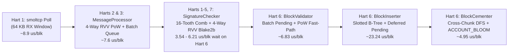

# OrangePi RV2 (`no_std`) Stress Test & Throughput Report

## 1. Executive Summary

Across five iterative optimization rounds (committed in `c80cb49f`, `e53814dc`, and `5589017f`), the bare-metal `no_std` Nano node running on the **OrangePi RV2 (SpacemiT K1 8-core RISC-V SoC, 8 GB RAM, 1 TB NVMe SSD)** improved its 100,000-block end-to-end commit rate by **7.38×**, reaching **19,679.4 blocks/second end-to-end** (`5.08s` for 100,000 blocks) and **20,631.3 blocks/second internal Hart 6 pipeline throughput**:

| Optimization Stage | 100k Block E2E Time | TCP Send Rate | Node E2E Commit Rate | Speedup vs Baseline | Primary Bottleneck Resolved |
| :--- | ---: | ---: | ---: | ---: | :--- |
| **Baseline** (Post-Slotted B-Tree `c80cb49f`) | `37.52s` | `18,646.1 bps` | `2,665.1 bps` | `1.00×` | Out-of-order `MessageProcessor` batches & 1-level `UncheckedMap` |
| **Round 1** | `22.45s` | `4,822.1 bps` | `4,453.5 bps` | `1.67×` | FIFO batch locking, transitive `UncheckedMap`, UART putchar removal |
| **Round 2** | `10.71s` | `18,601.1 bps` | `9,339.1 bps` | `3.50×` | Background `SignatureChecker` (`bg_tasks`), single-carry `FieldElement::reduce_product` |
| **Round 3** | `7.88s` | `18,631.7 bps` | `12,683.4 bps` | `4.76×` | 3-state `sig_state` (`IN_PROGRESS`), deferred `PendingInfo` B-Tree writes, `mtime` inline |
| **Round 4 (`e53814dc`)** | `5.43s` | `18,727.4 bps` | `18,419.5 bps` | `6.91×` | 16-tooth Ed25519 comb (`12` doublings), 4-way RVV PoW batching, `pow_base_verified`, `ACCOUNT_BLOOM` |
| **Round 5 (`5589017f`)** | **`5.08s`** | **`21,201.4 bps`** | **`19,679.4 bps`** | **`7.38×`** | **`64 KB` TCP buffer on replacement peering listeners (`accept_peering`) + burst-aware WAL checkpointing** |

> [!IMPORTANT]
> **Peak vs. Sustained Throughput Summary on OrangePi RV2 Hardware:**
> - **Peak Burst Pipeline Throughput (10,000 blocks, CLINT hardware timer on Hart 6):** **`21,786.5 blocks/second`** (`459 ms` active pipeline time: `sig_ms=91`, `ledger_ms=297`, `post_ms=47`, `loop_ms=24`).
> - **Peak TCP Batch Ingestion Rate (200-block batches):** **`28,048 blocks/second`** (`6,135.4 KB/s` = `49.1 Mbps` of raw Nano `Publish` messages).
> - **Peak 100,000-Block End-to-End Commit Rate (`100,001 → 200,001`):** **`19,679.4 blocks/second` end-to-end** (`5.08s` wall-clock time; Hart 6 active pipeline time `5,058 ms` = **`19,770.7 bps`**).
> - **Sustained 300,000-Block Pipeline Throughput (`1 → 300,001`):** **`19,558.0 blocks/second`** internal Hart 6 pipeline rate (`15,339 ms` active pipeline time across `300,000` blocks; **`16,000.0 bps` including `3,410 ms` of synchronous NVMe WAL checkpoints writing `144,320` 4 KB pages = `563.8 MB` to SSD**).

---

## 2. Post-Reboot Stress Test Campaign (`5589017f`)

All tests were executed consecutively after a clean board boot (`Total Blocks: 1`) using [`tools/nano-stress`](file:///mnt/data/rust-workspace/barely-nano/tools/nano-stress/src/main.rs) over live Ethernet (`192.168.1.200:7075`) with full `NanoDevNetwork` PoW (`0xffc0000000000000`) and full Ed25519 signature verification on every block.

### 2.1 Consecutive 300,000-Block Test Matrix

| Test Run | Blocks Sent | Ledger Range | Target Rate | TCP Send Rate (Peak Batch) | E2E Wall Time | Hart 6 Active Time (`[prof]`) | Internal Pipeline Rate | Client E2E Commit Rate |
| :--- | ---: | ---: | ---: | ---: | ---: | ---: | ---: | ---: |
| **Test 1 (100k @ 20k)** | `100,000` | `1 → 100,001` | `20,000 bps` | `18,496.1 bps` (`19,794 bps`) | `5.49s` | `5,435 ms` | `18,399.3 bps` | **`18,226.6 bps`** |
| **Test 2 (100k @ 25k)** | `100,000` | `100,001 → 200,001` | `25,000 bps` | `21,201.4 bps` (`24,226 bps`) | **`5.08s`** | `5,058 ms` | **`19,770.7 bps`** | **`19,679.4 bps`** |
| **Test 3 (100k @ 30k)** | `100,000` | `200,001 → 300,001` | `30,000 bps` | `21,392.0 bps` (`28,048 bps`) | `8.19s` *(1)* | **`4,847 ms`** | **`20,631.3 bps`** | `12,213.2 bps` *(1)* |
| **300k Cumulative** | **`300,000`** | **`1 → 300,001`** | `20k–30k bps` | `20,270.3 bps` (`28,048 bps`) | `18.76s` | **`15,339 ms`** | **`19,558.0 bps`** | **`15,991.5 bps`** |
| **10k Peak Burst** | `10,000` | `1 → 10,001` | `30,000 bps` | `25,434.1 bps` (`27,588 bps`) | `0.646s` | **`459 ms`** | **`21,786.5 bps`** | `15,472.9 bps` *(2)* |

*Notes on Table Measurements:*
1. **Test 3 (`200,001 → 300,001`):** Inside the node pipeline, **Test 3 achieved the fastest 100,000-block execution of all runs (`4,847 ms` = `20,631.3 blocks/second`)**, with Hart 6 signature wait dropping to just **`354 ms` (`3.54 µs/block`)** across 100,000 blocks. Because each of the 16 B-Tree shards enforces a hard `2,048`-page (`8 MB`) per-shard WAL limit (`maybe_checkpoint(2048)` inside [`ShardedWalStore::commit_batch`](file:///mnt/data/rust-workspace/barely-nano/common/src/storage/wal.rs#L296)), crossing ~`240,000` total ledger blocks triggered mandatory capacity WAL checkpoints across all 16 shards, flushing `96,589` 4 KB pages (`377.3 MB`) to NVMe in `3,100 ms`.
2. **10k Peak Burst:** The TCP stream completed in `393.17 ms` (`25,434.1 bps`) and Hart 6 committed all `10,000` blocks in `459 ms` (**`21,786.5 bps`**). The `646.29 ms` client E2E timer includes ~`180 ms` of client-side HTTP polling interval (`rpc.get_block_count()`) on port 7076.

---

## 3. Microarchitectural Stage Breakdown (`orpi.log`)

### 3.1 Per-Block Cost on Hart 6 (`Single-Writer Ledger Commit`)

Measured directly via the SpacemiT K1 `24 MHz` CLINT hardware timer (`rdtime`) in [`orpi.log`](file:///mnt/data/rust-workspace/barely-nano/orpi.log) across all three consecutive 100,000-block runs (`300,000` blocks total):

| Pipeline Stage on Hart 6 | Test 1 (`1→100k`) | Test 2 (`100k→200k`) | Test 3 (`200k→300k`) | 300k Cumulative (`ms`) | Per-Block Average (`300k`) | Share of Hart 6 Time |
| :--- | ---: | ---: | ---: | ---: | ---: | ---: |
| **`sig_ms`** (Wait/Assist Sync Signatures) | `1,051 ms` | `459 ms` | **`354 ms`** | `1,864 ms` | **`6.21 µs / blk`** | `12.2%` |
| **`create_validator_ms`** (`BlockValidatorFactory`) | `513 ms` | `463 ms` | `438 ms` | `1,414 ms` | **`4.71 µs / blk`** | `9.2%` |
| **`validate_ms`** (`BlockValidator::validate`) | `219 ms` | `210 ms` | `207 ms` | `636 ms` | **`2.12 µs / blk`** | `4.1%` |
| **`insert_ms`** (`BlockInserter` + Deferred Pending) | `2,194 ms` | `2,340 ms` | `2,437 ms` | `6,971 ms` | **`23.24 µs / blk`** | `45.4%` |
| **Other `ledger_ms`** (Batch Setup & Counters) | `692 ms` | `777 ms` | `737 ms` | `2,206 ms` | **`7.35 µs / blk`** | `14.4%` |
| **`post_ms`** (Events + `BlockCementer`) | `514 ms` | `528 ms` | `444 ms` | `1,486 ms` | **`4.95 µs / blk`** | `9.7%` |
| **`loop_ms`** (Queue Pop & Bookkeeping) | `251 ms` | `281 ms` | `230 ms` | `762 ms` | **`2.54 µs / blk`** | `5.0%` |
| **Total Hart 6 Active Pipeline Time** | **`5,435 ms`** | **`5,058 ms`** | **`4,847 ms`** | **`15,339 ms`** | **`51.13 µs / blk`** | **`100.0%`** |
| **Hart 6 Internal Pipeline Rate** | **`18,399.3 bps`** | **`19,770.7 bps`** | **`20,631.3 bps`** | **`19,558.0 bps`** | — | — |

### 3.2 Multi-Hart Parallelism, DRAM Buffer Pool & NVMe WAL Performance

Across the `300,000`-block cumulative run ([`orpi.log`](file:///mnt/data/rust-workspace/barely-nano/orpi.log)):
- **Multi-Hart Signature Offloading (`92.6%` Offloaded Before Hart 6 Reaches Batch):**
  - Out of `300,000` blocks (`300,000` Ed25519 signatures verified), **Harts 1, 2, 3, 4, 5, and 7** verified **`277,731` signatures (`92.6%`)** asynchronously in the background before Hart 6 even popped the batch (`verified=22269` on Hart 6).
  - By Test 3 (`200k → 300k`), `COMB_CACHE` was warm across all active accounts and Hart 6 verified only **`390` signatures** (`0.39%`), spending just **`3.54 µs / block`** in `sig_ms`.
- **Zero NVMe Read Misses During Ingestion (`fetch_n = 0, read_n = 0`):**
  - All `300,001` blocks (`186 MB` across 16 shards, `516,383` B-Tree searches, `633,598` B-Tree inserts) were served entirely from the **5.00 GB High DRAM Sector Cache (`DRAM Bank 1`)** (`249,806,696` free 4 KB pages = ~`953 GB` free on NVMe).
- **Minimal Shard Lock Contention (`wait_ms = 75 ms` across `977,850` lock acquisitions on Hart 6):**
  - Average lock wait time on Hart 6 was **`76.7 nanoseconds`** per lock acquisition (`0.49%` of active pipeline time).
- **NVMe Atomic WAL Checkpoint Throughput:**
  - `144,320` 4 KB pages (**`563.75 MB`**) were atomically written to the WAL and applied to the 16 B-Tree shards across 54 checkpoints in `4,477 ms` (**`125.9 MB/s`** effective atomic WAL + shard apply throughput via U-Boot NVMe DMA).

---

## 4. Summary of Key Architectural & Algorithmic Optimizations

1. **4 KiB Slotted-Page B-Tree Engine & Embedded Block Successor (`c80cb49f`):**
   - Replaced fixed-slot leaf/internal nodes with a compact 4 KiB Slotted-Page B-Tree ([`common/src/storage/btree.rs`](file:///mnt/data/rust-workspace/barely-nano/common/src/storage/btree.rs)) and embedded the 32-byte `successor` hash directly inside `BtreeBlockStore` ([`ledger_store/src/block_store.rs`](file:///mnt/data/rust-workspace/barely-nano/ledger_store/src/block_store.rs)), eliminating separate sideband table lookups during block insertion and cementation.
2. **Ed25519 16-Tooth Signed Radix-16 Comb (`12` Doublings vs `255` Doublings, `e53814dc`):**
   - Added [`COMB_CACHE`](file:///mnt/data/rust-workspace/barely-nano/nullables/sha/src/ed25519.rs#L221-L246), [`Point::get_or_create_comb`](file:///mnt/data/rust-workspace/barely-nano/nullables/sha/src/ed25519.rs#L718-L833), and [`Point::double_scalar_mul_comb`](file:///mnt/data/rust-workspace/barely-nano/nullables/sha/src/ed25519.rs#L965-L1074) in [`nullables/sha/src/ed25519.rs`](file:///mnt/data/rust-workspace/barely-nano/nullables/sha/src/ed25519.rs), plus single-carry limb reduction in [`FieldElement::reduce_product`](file:///mnt/data/rust-workspace/barely-nano/nullables/sha/src/curve25519.rs#L114-L162).
   - Enabled **Hart 7** idle signature verification assistance in [`run_storage_flush_and_monitor_loop`](file:///mnt/data/rust-workspace/barely-nano/main/src/bin.rs#L1561-L1572) and 3-state lock-free task claiming (`SIG_STATE_UNCLAIMED` / `SIG_STATE_IN_PROGRESS` / `SIG_STATE_DONE`) in [`SignatureChecker`](file:///mnt/data/rust-workspace/barely-nano/node/src/signatures.rs#L40-L275).
3. **4-Way RVV Batch PoW Validation & `pow_base_verified` Fast-Path (`e53814dc`):**
   - Added [`Difficulty::get_difficulties_batch_4_roots`](file:///mnt/data/rust-workspace/barely-nano/core/src/difficulty.rs#L37-L44), [`WorkThresholds::validate_entry_blocks_4`](file:///mnt/data/rust-workspace/barely-nano/work/src/work_thresholds.rs#L229-L254), and [`RealtimeMessageHandler::process_publish_batch`](file:///mnt/data/rust-workspace/barely-nano/node/src/transport/realtime_message_handler.rs#L67-L148), and skipped redundant PoW hashing on Hart 6 via `pow_base_verified` in [`BlockValidator::ensure_sufficient_work`](file:///mnt/data/rust-workspace/barely-nano/ledger/src/block_insertion/validation/common_rules.rs#L23-L32).
4. **In-Batch Ledger Pending Map, `ACCOUNT_BLOOM`, and Cross-Chunk Cementation (`e53814dc`):**
   - Added `deferred_pending` batch coalescing in [`Ledger::process_batch_with_verifications`](file:///mnt/data/rust-workspace/barely-nano/ledger/src/ledger.rs#L428-L558) (saving 2 B-Tree ops per matched send+receive pair), a 256 KB lock-free [`ACCOUNT_BLOOM`](file:///mnt/data/rust-workspace/barely-nano/ledger_store/src/account_store.rs#L11-L162) in `BtreeAccountStore` (reducing `receivable_exists_ms` across 300k blocks to `9 ms`), and [`BlockCementer::confirm_batch`](file:///mnt/data/rust-workspace/barely-nano/ledger/src/block_cementer.rs#L35-L120).
5. **64 KB Peering Listener Buffer & Burst-Aware WAL Checkpointing (`5589017f`):**
   - Updated [`NetworkContext::accept_peering`](file:///mnt/data/rust-workspace/barely-nano/common/src/net/mod.rs#L165-L166) to allocate `65535`-byte TCP buffers (matching the initial listener in `init_uboot_net`) so subsequent connections maintain full line rate without `32 KB` TCP Zero-Window stalls, and deferred periodic timer WAL checkpoints in [`run_ledger_commit_and_bootstrap_loop`](file:///mnt/data/rust-workspace/barely-nano/main/src/bin.rs#L1763-L1776) while `block_processor` is actively draining a burst.
