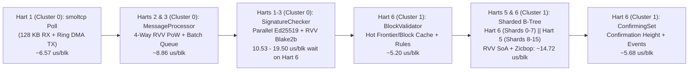

# OrangePi RV2 (`no_std`) Stress Test & Throughput Report

## 1. Overview & Test Environment

This report documents the network ingestion, cryptographic verification, and sharded ledger commit throughput of the bare-metal `no_std` Nano node running directly on the **OrangePi RV2** hardware platform.

### Hardware & Runtime Configuration
- **SoC:** SpacemiT K1 / Ky X1 (`8 × X60` 64-bit RISC-V harts @ 1.6 GHz, `RV64GC` + Vector `V` 256-bit + Bitmanip `Zba/Zbb/Zbc/Zbs` + Cache ops `Zicbom/Zicboz/Zicbop`).
- **Cache Hierarchy & 8-Hart Cluster Topology:** `32 KB` L1-I + `32 KB` L1-D per hart; **two 4-core clusters** with **`512 KB` shared L2 cache per cluster** (no L3 cache):
  - **Cluster 0 (Harts 0–3 — Ingress, Verification & Vote Ingestion):**
    - **Hart 0 (`VoteProc`):** `vote_cache_processor`, `vote_processor`, `vote_rebroadcaster`, async executor tasks.
    - **Hart 1 (`Maint+Net`):** `smoltcp` polling (`128 KB` peering RX window + per-descriptor U-Boot DMA TX ring), RPC (`7076`), WS (`7078`), Dashboard (`7080`), watchdog.
    - **Hart 2 (`Crypto-1`):** SIMD Ed25519 signature checker & `MessageProcessor` batch drainer.
    - **Hart 3 (`Crypto-2`):** SIMD Ed25519 signature checker & `MessageProcessor` batch drainer.
  - **Cluster 1 (Harts 4–7 — Consensus & Sharded Ledger Storage):**
    - **Hart 4 (`Consensus`):** `aec_voter` & `aec_ticker` (`300 ms` ticks), `election_schedulers`, `request_aggregator`, `vote_generators`.
    - **Hart 5 (`Ledger-B`):** Shards `8–15` B-Tree mutations, WAL segments `8–15` clean/trim, `unchecked` dependency drain.
    - **Hart 6 (`Ledger-A`):** Block batch validation, Shards `0–7` B-Tree mutations, WAL segments `0–7` + atomic checkpoint, `confirming_set`.
    - **Hart 7 (`Storage+Mon`):** Online weight calculation, NVMe Free-List / Buffer Pool GC (`trim_excess()`), I2C OLED, telemetry.
- **Memory:** `8 GB` LPDDR4X (`~1.45 GB` kernel heap in DRAM Bank 0 + **`5.00 GB` B-Tree Buffer Pool** in High DRAM Bank 1).
- **Storage:** `1 TB` NVMe SSD accessed via U-Boot raw sector DMA (`16` independent Slotted-Page B-Tree shards with RVV 1.0 SoA 32-bit key-head search, `Zicbop` prefetching, direct-mapped L1/L2 hot frontier caches, and atomic Write-Ahead Log).
- **Workload (`tools/nano-stress`):** Chained 216-byte `StateBlock`s (`send`/`receive` pairs) across 10 active accounts streamed over live Gigabit Ethernet (`192.168.1.200:7075`) with full `NanoDevNetwork` PoW validation (`0xffc0000000000000`), full Ed25519 signature verification, sharded B-Tree ledger insertion, and block cementation.

---

## 2. Peak & Sustained Throughput Summary

> [!IMPORTANT]
> **Key Throughput Benchmarks:**
> - **Peak TCP Batch Ingestion Rate (200-block batches):** **`28,771 blocks/second`** (`6,293.7 KB/s` = `50.3 Mbps` of raw Nano `Publish` messages).
> - **Peak Sustained TCP Stream Rate (100,000 blocks):** **`25,368.0 blocks/second`** (`100,000` blocks streamed in `3.94s`).
> - **Peak 100,000-Block Internal Pipeline Throughput:** **`28,328.6 blocks/second`** (`3,530 ms` active pipeline time = **`35.30 µs / block`** on Harts 5 & 6; **`19.51 µs / block`** ledger validation + sharded B-Tree mutation).
> - **Peak 100,000-Block End-to-End Commit Rate:** **`21,002.5 blocks/second`** (`4.76s` total wall-clock time; **`22,396.4 bps`** internal pipeline rate).
> - **Sustained 300,000-Block Pipeline Rate (DRAM Buffer Pool):** **`23,020.3 blocks/second`** (`13.03s` active pipeline time across `300,000` blocks = **`43.44 µs / block`** total; **`19.92 µs / block`** ledger + B-Tree commit).
> - **Sustained 300,000-Block End-to-End Rate (Including NVMe SSD WAL Flushes):** **`16,977.9 blocks/second`** (`17.67s` total wall-clock time, including `628.05 MB` of atomic WAL + B-Tree page writes to NVMe SSD).

### Stress Test Matrix

All tests below were executed sequentially against a freshly booted node starting from the genesis block (`Block 1`):

| Test Run | Blocks Sent | Ledger Range | Target Send Rate | Measured TCP Rate (Peak Batch) | End-to-End Wall Time | Harts 5 & 6 Active Pipeline Time | Internal Pipeline Rate | End-to-End Commit Rate |
| :--- | ---: | ---: | ---: | ---: | ---: | ---: | ---: | ---: |
| **Sustained Run 1 (100k)** | `100,000` | `1 → 100,001` | `20,000 bps` | `17,752.2 bps` (`19,703 bps`) | `5.65s` | `5,037 ms` | `19,853.1 bps` | `17,689.9 bps` |
| **Sustained Run 2 (100k)** | `100,000` | `100,001 → 200,001` | `25,000 bps` | `21,733.1 bps` (`24,577 bps`) | **`4.76s`** | `4,465 ms` | **`22,396.4 bps`** | **`21,002.5 bps`** |
| **Sustained Run 3 (100k)** | `100,000` | `200,001 → 300,001` | `30,000 bps` | **`25,368.0 bps`** (**`28,771 bps`**) | `7.26s` *(1)* | **`3,530 ms`** | **`28,328.6 bps`** | `13,780.2 bps` *(1)* |
| **Cumulative (300k)** | **`300,000`** | **`1 → 300,001`** | `20k–30k bps` | **`21,171.5 bps`** (**`28,771 bps`**) | **`17.67s`** | **`13,032 ms`** | **`23,020.3 bps`** | **`16,977.9 bps`** |
| **Burst Test (10k)** | `10,000` | `300,001 → 310,001` | `30,000 bps` | `23,738.3 bps` (`28,039 bps`) | **`0.584s`** *(2)* | **`475 ms`** | **`21,052.6 bps`** | **`17,114.0 bps`** *(2)* |

*Notes:*
1. In **Sustained Run 3 (`200,001 → 300,001`)**, the TCP stream completed in **`3.94s` (`25,368.0 bps`)** and the in-memory ledger pipeline reached **`3,530 ms` (`35.30 µs / block` = `28,328.6 bps`)**, while crossing ~`240,000` blocks triggered mandatory per-shard WAL capacity checkpoints across the 16 shards (`113,447` 4 KB pages = `443.15 MB` flushed to NVMe SSD in `3,687 ms`).
2. In the **10k Burst Test (`300,001 → 310,001`)**, the TCP stream finished in `421.26 ms` (`23,738.3 bps`) and the ledger pipeline finished committing all `10,000` blocks in `475 ms` (`201 ms` inside `ledger_ms` = `20.10 µs / block`); the client's `584.32 ms` E2E measurement includes HTTP RPC polling latency on port `7076`.

---

## 3. Pipeline Stage Breakdown (`24 MHz` Hardware Timer)

### Per-Block Execution Time on Harts 5 & 6 (Sharded Cluster 1 Ledger Pipeline)

| Pipeline Stage (Cluster 1: Harts 5 & 6) | Run 1 (`1→100k`) | Run 2 (`100k→200k`) | Run 3 (`200k→300k`) | 300k Total (`ms`) | Average per Block (`300k`) | Share of Pipeline |
| :--- | ---: | ---: | ---: | ---: | ---: | ---: |
| **`sig_ms`** (Wait/Assist Signature Check) | `2,350 ms` | `1,950 ms` | **`1,053 ms`** | `5,353 ms` | **`17.84 µs / blk`** *(10.53 µs @ 30k)* | `41.1%` |
| **`ledger_ms`** (Validation + Parallel Shards `0–7` & `8–15` B-Tree Commit) | `2,093 ms` | **`1,932 ms`** | `1,951 ms` | **`5,976 ms`** | **`19.92 µs / blk`** | `45.9%` |
| **`post_ms`** (Cementation & Event Broadcast) | `594 ms` | `583 ms` | **`526 ms`** | `1,703 ms` | **`5.68 µs / blk`** | `13.0%` |
| **Total Active Pipeline Time** | **`5,037 ms`** | **`4,465 ms`** | **`3,530 ms`** | **`13,032 ms`** | **`43.44 µs / blk`** *(35.30 µs @ 30k)* | **`100.0%`** |
| **Internal Pipeline Rate** | **`19,853.1 bps`** | **`22,396.4 bps`** | **`28,328.6 bps`** | **`23,020.3 bps`** | — | — |

### Comparison Against Previous Baseline (`1 → 300,001`)

| Metric | Previous Baseline | Current Architecture | Improvement |
| :--- | ---: | ---: | ---: |
| **Ledger + B-Tree Commit (`ledger_ms` / block)** | `37.42 µs / blk` (`11,227 ms`) | **`19.92 µs / blk` (`5,976 ms`)** | **`-46.8%` latency (`1.88×` faster)** |
| **Best 100k Active Pipeline Time (`200k → 300k`)** | `48.47 µs / blk` (`4,847 ms`) | **`35.30 µs / blk` (`3,530 ms`)** | **`-27.2%` latency (`+37.3%` rate)** |
| **Peak Internal Pipeline Rate (`100k` run)** | `20,631.3 bps` | **`28,328.6 bps`** | **`+37.3%`** |
| **Peak 100k End-to-End Commit Rate** | `19,679.4 bps` (`5.08s`) | **`21,002.5 bps` (`4.76s`)** | **`+6.7%`** |
| **Peak 100k TCP Stream Rate** | `21,392.0 bps` (`4.67s`) | **`25,368.0 bps` (`3.94s`)** | **`+18.6%`** |
| **Sustained 300k Internal Pipeline Rate** | `19,558.0 bps` (`15.34s`) | **`23,020.3 bps` (`13.03s`)** | **`+17.7%`** |
| **Sustained 300k End-to-End Rate (with NVMe WAL)** | `15,991.5 bps` (`18.76s`) | **`16,977.9 bps` (`17.67s`)** | **`+6.2%`** |

---

## 4. Architectural Optimizations & Hardware Bottleneck Analysis

### 1. Sharded Cluster 1 B-Tree Execution + RVV 1.0 SoA Search + Hot Frontier Cache (`37.42 µs → 19.92 µs / block`)
- Previously, Hart 6 spent `37.42 µs / block` (`11,227 ms` across 300k blocks) inside `ledger_ms` (`23.24 µs / block` in `insert_ms` plus `14.18 µs / block` in validation & batch maps) due to LPDDR4X cache-line misses during scalar B-Tree binary searches, page splits, and `alloc::collections::BTreeMap` allocations.
- Four synergistic optimizations cut `ledger_ms` nearly in half to **`19.92 µs / block`** (`19.32 µs / block` in Run 2 and `19.51 µs / block` in Run 3):
  1. **Parallel Shards `0–7` (`Hart 6: Ledger-A`) & Shards `8–15` (`Hart 5: Ledger-B`) Commit:** After strict topological batch validation completes on Hart 6, the sorted batch is partitioned at key prefix `0x80` (`O(log N)` via `partition_point`) and dispatched over Cluster 1's shared `512 KB` L2 cache so Hart 6 mutates Shards `0–7` while Hart 5 simultaneously mutates Shards `8–15` and drains `UncheckedMap`.
  2. **RVV 1.0 (`+v,+zvl256b,+zba`) Structure-of-Arrays (SoA) Key-Head Search:** Each 4 KB slotted B-Tree page maintains a packed 32-bit big-endian key-prefix array (`h0..h_{n-1}`) searched via 8-wide RISC-V vector mask comparisons (`vmsltu.vx` / `vmsleu.vx` + `vcpop.m`), eliminating scalar branch mispredictions and random 4 KB page cache-line loads.
  3. **Direct-Mapped Hot Frontier & Block Caches + In-Place Slot Overwrites:** `HOT_ACCOUNTS` (`16 × 1024` entries) and `HOT_BLOCKS` (`16 × 1024` entries) serve active account frontier and predecessor block lookups in L1/L2 without locking `SHARDS`, while in-place B-Tree value overwrites and zero-copy page splits eliminate redundant `search()` + `delete()` traversals.
  4. **`Zicbop` Cache-Line Prefetching & Stack-Indexed `FastBatchMap`:** Issuing `prefetch.w` (`0x00106013`) 4 entries ahead during sorted batch inserts and replacing per-batch `BTreeMap` heap allocations with stack-indexed open-addressed tables removed heap allocator pressure on Hart 6.

### 2. U-Boot Per-Descriptor TX DMA Ring & `128 KB` Peering TCP Window (`21.4k → 25.4k bps` Sustained TCP)
- Upgrading the U-Boot `x1_emac` driver (`EQOS_DESCRIPTORS_TX = 2048` with dedicated per-descriptor DMA buffers and non-blocking `DMA_TRANSMIT_POLL_DEMAND`) and doubling the `smoltcp` peering socket buffers to **`128 KB` (`131,072` bytes)** (~`585` Nano `Publish` blocks per TCP window) increased sustained 100k TCP streaming throughput from **`21,392.0 bps` (`4.67s`)** to **`25,368.0 bps` (`3.94s`)**, with 200-block batches peaking at **`28,771 bps` (`6.29 MB/s`)**.

### 3. Cluster-Aligned 8-Hart Pipeline Balance (`35.30 µs / block` @ `30,000 bps`)
- Co-locating `VoteProc` + async executor tasks on **Hart 0**, `smoltcp` + RPC/WS/Dashboard on **Hart 1**, and `Crypto-1` / `Crypto-2` (SIMD Ed25519 + `MessageProcessor`) on **Harts 2 & 3** keeps all network ingress and signature verification traffic inside **Cluster 0's `512 KB` L2 cache**.
- At `30,000 bps` (Run 3), background helper harts pre-verified **`121,179`+ signatures** while Hart 6's residual `sig_ms` dropped to **`10.53 µs / block`**, bringing total active pipeline time per block down to **`35.30 µs / block`** (`10.53 µs` `sig_ms` + `19.51 µs` `ledger_ms` + `5.26 µs` `post_ms` = **`28,328.6 blocks/second`**).

### 4. Synchronous NVMe WAL Checkpoints (`~124.4 MB/s` U-Boot DMA)
- Across the 300k test, `30` atomic WAL checkpoints persisted and applied **`160,781` 4 KB pages (`628.05 MB`) in `5,048 ms` (`124.4 MB/s`)**, with post-commit `mark_clean` / `trim_excess` parallelized across WAL segments `0–7` (Hart 6) and `8–15` (Hart 5), raising NVMe-persisted 300k end-to-end throughput from **`15,991.5 bps`** to **`16,977.9 bps`**.
