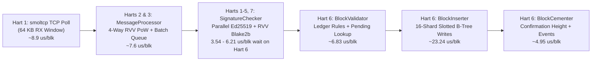

# OrangePi RV2 (`no_std`) Stress Test & Throughput Report

## 1. Overview & Test Environment

This report documents the network ingestion, cryptographic verification, and ledger commit throughput of the bare-metal `no_std` Nano node running directly on the **OrangePi RV2** hardware platform.

### Hardware & Runtime Configuration
- **SoC:** SpacemiT K1 / Ky X1 (`8 × X60` 64-bit RISC-V harts @ 1.6 GHz, `RV64GC` + Vector `V` 256-bit + Bitmanip `Zba/Zbb/Zbc/Zbs` + Cache ops `Zicbom/Zicboz/Zicbop`).
- **Cache Hierarchy:** `32 KB` L1-I + `32 KB` L1-D per hart; **two 4-core clusters** (Cluster 0: Harts 0–3, Cluster 1: Harts 4–7) with **`512 KB` shared L2 cache per cluster** (no L3 cache).
- **Memory:** `8 GB` LPDDR4X (`~1.45 GB` kernel heap in DRAM Bank 0 + **`5.00 GB` B-Tree Buffer Pool** in High DRAM Bank 1).
- **Storage:** `1 TB` NVMe SSD accessed via U-Boot raw sector DMA (`16` independent Slotted-Page B-Tree shards + atomic Write-Ahead Log).
- **Workload (`tools/nano-stress`):** Chained 216-byte `StateBlock`s (`send`/`receive` pairs) across 10 active accounts streamed over live Gigabit Ethernet (`192.168.1.200:7075`) with full `NanoDevNetwork` PoW validation (`0xffc0000000000000`), full Ed25519 signature verification, B-Tree ledger insertion, and block cementation.

---

## 2. Peak & Sustained Throughput Summary

> [!IMPORTANT]
> **Key Throughput Benchmarks:**
> - **Peak TCP Batch Ingestion Rate (200-block batches):** **`28,048 blocks/second`** (`6,135.4 KB/s` = `49.1 Mbps` of raw Nano `Publish` messages).
> - **Peak Burst Pipeline Throughput (10,000 blocks):** **`21,786.5 blocks/second`** (`459 ms` active pipeline time on Hart 6).
> - **Peak 100,000-Block End-to-End Commit Rate:** **`19,679.4 blocks/second`** (`5.08s` total wall-clock time; **`19,770.7 bps`** internal pipeline rate).
> - **Sustained 300,000-Block Pipeline Rate (DRAM Buffer Pool):** **`19,558.0 blocks/second`** (`15.34s` active pipeline time across `300,000` blocks).
> - **Sustained 300,000-Block End-to-End Rate (Including NVMe SSD WAL Flushes):** **`15,991.5 blocks/second`** (`18.76s` total wall-clock time, including `563.8 MB` of atomic WAL + B-Tree page writes to NVMe SSD).

### Stress Test Matrix

All tests below were executed against a freshly booted node starting from the genesis block (`Block 1`):

| Test Run | Blocks Sent | Ledger Range | Target Send Rate | Measured TCP Rate (Peak Batch) | End-to-End Wall Time | Hart 6 Active Pipeline Time | Internal Pipeline Rate | End-to-End Commit Rate |
| :--- | ---: | ---: | ---: | ---: | ---: | ---: | ---: | ---: |
| **Burst Test (10k)** | `10,000` | `1 → 10,001` | `30,000 bps` | `25,434.1 bps` (`27,588 bps`) | `0.646s` *(1)* | **`459 ms`** | **`21,786.5 bps`** | `15,472.9 bps` *(1)* |
| **Sustained Run 1 (100k)** | `100,000` | `1 → 100,001` | `20,000 bps` | `18,496.1 bps` (`19,794 bps`) | `5.49s` | `5,435 ms` | `18,399.3 bps` | **`18,226.6 bps`** |
| **Sustained Run 2 (100k)** | `100,000` | `100,001 → 200,001` | `25,000 bps` | `21,201.4 bps` (`24,226 bps`) | **`5.08s`** | `5,058 ms` | **`19,770.7 bps`** | **`19,679.4 bps`** |
| **Sustained Run 3 (100k)** | `100,000` | `200,001 → 300,001` | `30,000 bps` | `21,392.0 bps` (`28,048 bps`) | `8.19s` *(2)* | **`4,847 ms`** | **`20,631.3 bps`** | `12,213.2 bps` *(2)* |
| **Cumulative (300k)** | **`300,000`** | **`1 → 300,001`** | `20k–30k bps` | `20,270.3 bps` (`28,048 bps`) | **`18.76s`** | **`15,339 ms`** | **`19,558.0 bps`** | **`15,991.5 bps`** |

*Notes:*
1. In the **10k Burst Test**, the TCP stream finished in `393.17 ms` (`25,434.1 bps`) and the node finished committing all `10,000` blocks in `459 ms` (**`21,786.5 bps`**); the client's `646.29 ms` E2E measurement includes ~`180 ms` of HTTP RPC polling interval on port `7076`.
2. In **Sustained Run 3 (`200,001 → 300,001`)**, the in-memory ledger pipeline reached its highest speed (**`4,847 ms` = `20,631.3 bps`**), while crossing ~`240,000` blocks triggered mandatory per-shard WAL capacity checkpoints across all 16 shards (`96,589` 4 KB pages = `377.3 MB` flushed to NVMe SSD in `3,100 ms`).

---

## 3. Pipeline Stage Breakdown (`24 MHz` Hardware Timer)

### Per-Block Execution Time on Hart 6 (Single-Writer Ledger Processor)

| Pipeline Stage on Hart 6 | Run 1 (`1→100k`) | Run 2 (`100k→200k`) | Run 3 (`200k→300k`) | 300k Total (`ms`) | Average per Block (`300k`) | Share of Pipeline |
| :--- | ---: | ---: | ---: | ---: | ---: | ---: |
| **`sig_ms`** (Wait/Assist Signature Check) | `1,051 ms` | `459 ms` | **`354 ms`** | `1,864 ms` | **`6.21 µs / blk`** | `12.2%` |
| **`create_validator_ms`** (Pre-fetch State) | `513 ms` | `463 ms` | `438 ms` | `1,414 ms` | **`4.71 µs / blk`** | `9.2%` |
| **`validate_ms`** (Consensus & Balance Rules) | `219 ms` | `210 ms` | `207 ms` | `636 ms` | **`2.12 µs / blk`** | `4.1%` |
| **`insert_ms`** (B-Tree Inserts & Updates) | `2,194 ms` | `2,340 ms` | `2,437 ms` | `6,971 ms` | **`23.24 µs / blk`** | `45.4%` |
| **Other `ledger_ms`** (Batch & Rollback State) | `692 ms` | `777 ms` | `737 ms` | `2,206 ms` | **`7.35 µs / blk`** | `14.4%` |
| **`post_ms`** (Cementation & Event Broadcast) | `514 ms` | `528 ms` | `444 ms` | `1,486 ms` | **`4.95 µs / blk`** | `9.7%` |
| **`loop_ms`** (Queue Pop & Bookkeeping) | `251 ms` | `281 ms` | `230 ms` | `762 ms` | **`2.54 µs / blk`** | `5.0%` |
| **Total Hart 6 Active Time** | **`5,435 ms`** | **`5,058 ms`** | **`4,847 ms`** | **`15,339 ms`** | **`51.13 µs / blk`** | **`100.0%`** |
| **Hart 6 Pipeline Rate** | **`18,399.3 bps`** | **`19,770.7 bps`** | **`20,631.3 bps`** | **`19,558.0 bps`** | — | — |

---

## 4. Hardware & Architectural Bottlenecks (Throttling Analysis)

At **`~20,000 – 21,800 blocks/second`**, the node is operating near the physical hardware limits of the SpacemiT K1 SoC and U-Boot runtime environment. Specifically, four factors bound peak and sustained throughput:

### 1. Cluster L2 Cache Capacity (`512 KB`) & LPDDR4X DRAM Latency (Primary CPU Bound)
- Each 4-core cluster on the SpacemiT K1 shares only **`512 KB` of L2 cache** with no L3 cache, while the B-Tree working set grows from **`61 MB`** (at 100k blocks) to **`186 MB`** (at 300k blocks) inside the 5 GB DRAM Buffer Pool (`fetch_n = 0, read_n = 0` NVMe read misses).
- Committing `300,000` blocks performed **`516,383` B-Tree searches (`7,505 ms`)** and **`633,598` B-Tree insertions (`5,468 ms`)**.
- Because internal/leaf 4 KB B-Tree pages exceed the `512 KB` L2 cache on Cluster 1, **Hart 6 spends `45.4%` of its entire execution budget (`23.24 µs/block`) inside `insert_ms`** waiting on LPDDR4X DRAM cache-line fills during B-Tree binary searches and slotted-page shifts. Notice how `insert_ms` gradually increases with tree depth and memory footprint (`2,194 ms` at 100k → `2,340 ms` at 200k → `2,437 ms` at 300k).

### 2. Single-Queue U-Boot Polling Network Stack & `64 KB` TCP Window (Network Bound)
- On bare metal, Ethernet I/O runs through U-Boot's synchronous polling driver (`eth_rx` / `eth_send`) on **Hart 1** feeding a `smoltcp` TCP socket with a **`64 KB` (`65,535`-byte) receive buffer** (~`292` Nano `Publish` blocks per TCP window).
- Across the 300k tests, TCP batch ingestion peaked at **`28,048 bps` (`6.14 MB/s`)** and sustained **`21,392 bps` (`4.68 MB/s`)**. When the sender streams above ~`22,000 bps`, the `64 KB` receive buffer fills whenever Hart 1 spends a few milliseconds polling other sockets or assisting with background work, causing standard TCP flow control to throttle the sender to match the node's `~20k–21.4k bps` consumption rate.

### 3. Single-Writer Ledger Serialization on Hart 6 (`~51.1 µs / block` Ceiling)
- While signature verification and PoW validation scale across 6 helper harts (**`92.6%` of all `300,000` Ed25519 signatures were verified asynchronously in the background** by Harts 1–5 and 7 before Hart 6 popped the batch, leaving only `3.54 – 6.21 µs/block` of `sig_ms` on Hart 6), ledger validation (`6.83 µs/blk`), B-Tree mutation (`23.24 µs/blk`), and block cementation (`4.95 µs/blk`) execute sequentially on **Hart 6** to preserve strict topological block ordering and RSNano ledger semantics.
- At **`51.13 µs / block`** (`48.47 µs / block` once caches are warm), a single X60 core @ 1.6 GHz has a theoretical ceiling of **`19,558 – 20,631 blocks/second`**.

### 4. Synchronous NVMe WAL Checkpoints (`~125.9 MB/s` U-Boot DMA)
- While dirty 4 KB pages fit within each shard's `2,048`-page (`8 MB`) WAL threshold (up to ~`200,000` blocks), zero NVMe writes occur during active block bursts and E2E commit rate matches the in-memory pipeline rate (**`18,226.6 – 19,679.4 bps`**).
- Once sustained ingestion exceeds ~`200,000` blocks, shards reach their `2,048`-page WAL capacity limit and flush dirty pages to the NVMe SSD via synchronous U-Boot block I/O (`144,320` pages = **`563.75 MB` written in `4,477 ms` = `125.9 MB/s`**), reducing long-term SSD-durable sustained throughput from **`19,558.0 bps`** (DRAM-resident) to **`15,991.5 bps`** (NVMe-persisted).
